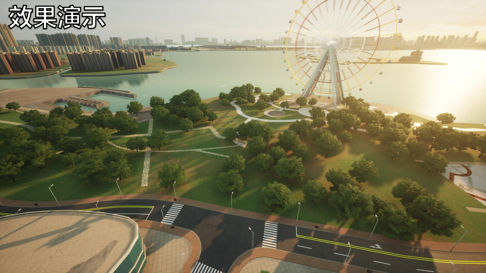
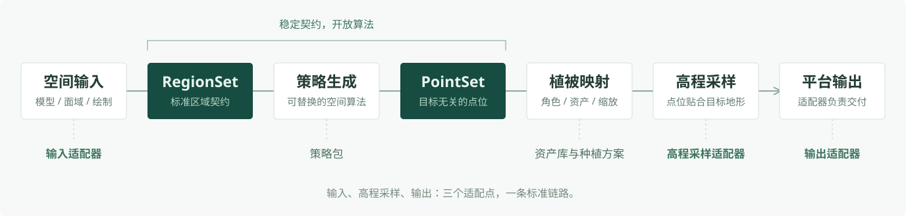

  

  <strong>VerdFlow 是一套可扩展的植被生成工作流。</strong> 
  以标准区域与点位契约，连接不同的数据来源、空间策略与目标平台。

  <a href="https://mr-pardon.github.io/verdflow-site/">文档</a> ·
  <a href="https://mr-pardon.github.io/verdflow-site/guide/install.html">安装</a> ·
  <a href="CHANGELOG.md">更新日志</a> ·
  <a href="#workflow">核心链路</a> ·
  <a href="#extend">拓展创作</a>

 

## 认识 VerdFlow

**从区域到植被，把一次种植变成可复用的工作流。**

VerdFlow 面向三维场景中的程序化植被种植。你可以从模型提取绿地、导入地理面域，或直接在场景中绘制选区；再选择种植策略、搭配植被资源，调整疏密、间距与构图参数，让生成的点位贴合地形，最终输出到目标场景。配置好的搭配与参数可以保存为种植方案，供下一次直接复用。

它的核心设计是将**空间算法、植被资源与平台接入分开**：策略负责植被如何分布，搭配负责使用哪些资源，适配器负责连接数据与场景。这让新增算法、替换资源和接入新平台可以分别推进，而不必为每一种组合重做整套流程。

### 从飞渡 DTS 起步，面向更多平台

| 目标平台 | 当前状态 | 可以走向哪里 |
| :--- | :--- | :--- |
| **飞渡 DTS** | 已支持 | 在实时场景中选区、采样并回写植被，或通过工作台生成 DTS XML |
| **Blender** | 规划中 | 直接向 Blender 场景生成植被实例，连接场景创作与资源管理 |
| **更多三维工具与实时引擎** | 探索方向 | 例如基于 **CesiumJS**、**Three.js** 的应用；为地图与三维场景接入区域驱动的植被生成、资源搭配与结果交付流程 |

Blender 目前已用于 FBX 工作流的几何处理，场景种植仍在规划中。其余列举平台为待评估的拓展方向，尚未接入或排期；植被模型与平台资源不会自动跨平台通用。

 

## 看见 VerdFlow

选择一片区域，搭配植被、调整参数，让种植结果落到场景中。

**[DTS 实时种植路径演示 · 49 秒](https://mr-pardon.github.io/verdflow-site/demo.html)**

点击封面观看完整演示。本片展示 DTS 实时种植路径；FBX 与地理数据工作流见下方指南。顶部横幅为品牌概念图。

 

## 从已有数据开始

**三个开始入口，两种交互模式，一条共用的种植链路。**

  

    <a href="https://mr-pardon.github.io/verdflow-site/workflows/live.html">
      <picture>
        <source media="(max-width: 840px)" srcset="docs/media/readme/route-live-mobile.svg">
        
      </picture>
    </a>
  

  

    <a href="https://mr-pardon.github.io/verdflow-site/workflows/fbx.html">
      <picture>
        <source media="(max-width: 840px)" srcset="docs/media/readme/route-fbx-mobile.svg">
        
      </picture>
    </a>
  

  

    <a href="https://mr-pardon.github.io/verdflow-site/workflows/geospatial.html">
      <picture>
        <source media="(max-width: 840px)" srcset="docs/media/readme/route-geospatial-mobile.svg">
        
      </picture>
    </a>
  

[DTS 实时种植指南](https://mr-pardon.github.io/verdflow-site/workflows/live.html) · [FBX 工作流指南](https://mr-pardon.github.io/verdflow-site/workflows/fbx.html) · [地理数据工作流指南](https://mr-pardon.github.io/verdflow-site/workflows/geospatial.html)

DTS 入口使用实时面板；FBX 与地理数据入口使用 Studio 项目工作台。两种模式都支持预设种植方案与手动配置。

FBX 工作流需要 Blender。地理数据需预先对齐到一致的米制坐标系，VerdFlow 不负责坐标重投影。

 

## 一条标准链路，多种生长方式

**区域定义在哪里生长，策略决定如何分布，搭配决定种下什么，高程让点位贴合地形。**

<picture>
  <source media="(max-width: 600px)" srcset="docs/media/readme/pipeline-mobile.svg">
  
</picture>

链路围绕两个标准契约展开：

- **`RegionSet`：统一区域表达。** 模型提取、地理数据和场景绘制进入同一套区域契约，策略不必分别处理每种源格式。
- **`PointSet`：目标无关的点位。** 策略输出空间分布与角色，具体植被、缩放、地形高程和平台格式由后续模块处理。

工作台与实时面板共用核心种植链路。切换交互方式，不需要重写一套生成算法。

 

## 扩展能力，不重建链路

**让新增能力留在它所属的模块里。** 空间算法、资源内容、平台接入和交互界面分别演进，不把差异集中到一个不断膨胀的核心。

| 想扩展什么 | 负责什么 | 从哪里开始 |
| :--- | :--- | :--- |
| **种植算法** | 定义角色、参数与空间分布，输出标准点位 | [策略包](strategy-packs/README.md) · [VFS Author](packages/authoring-kits/README.md) |
| **植被资源与预设** | 整理资产索引；用种植方案复用搭配、缩放与参数 | [资产包](packages/asset-package/README.md) · [VFA Author](packages/authoring-kits/README.md) · [方案包](packages/profile-package/README.md) |
| **区域来源** | 将新格式或外部选区转换为标准区域 | [Blender Adapter](adapters/blender-worker/README.md) · [Geospatial Adapter](adapters/geospatial-worker/README.md) |
| **高程来源** | 按采样契约返回地形高程 | [Core 能力端口](packages/core/README.md) · [DTS Adapter](adapters/dts/README.md) |
| **输出平台** | 按目标资源绑定，将已解析的实例转换为平台格式 | [DTS Adapter](adapters/dts/README.md) · [核心契约](packages/contracts/README.md) |

### 边界不仅是目录划分

- **策略只处理种植逻辑。** 不解析 FBX，不调用 DTS SDK，也不管理资产库。用途说明和可选样本地块随策略包分发，界面无需为每个策略写专属分支。
- **Core 通过能力端口编排。** Host 组合具体实现，外部 SDK 类型止于 Adapter，不进入核心契约。
- **界面消费能力，不复制业务。** Studio 与 WebUI 共享通用展示，参数示例的绘制由应用负责，样本空间分布由策略提供。

[模块边界](docs/architecture/MODULE_BOUNDARIES.md) · [架构决策（ADR）](docs/adr/README.md) · [开发与测试](docs/development/TESTING.md)

 

## 开始使用与创作

### 先完成一次种植

准备目标场景中的植被资源，导入策略和资产库，再选择种植方案或手动配置。

| 你需要 | 用途 | 获取 |
| :--- | :--- | :--- |
| **VerdFlow Studio** | Windows x64 桌面客户端，进入工作台或连接 DTS 实时种植 | 下载地址待发布 |
| **用户手册** | 安装准备、操作流程与常见问题 | [在线阅读](https://mr-pardon.github.io/verdflow-site/) |
| **策略包** | 空间算法、植被角色与可调参数 | [资源中心](https://mr-pardon.github.io/verdflow-resources/?type=strategies) |
| **资产库** | 植被资源索引、参考尺寸与搭配素材 | [资源中心](https://mr-pardon.github.io/verdflow-resources/?type=assets) |

资产库不包含 DTS 模型文件。目标平台、模型资源与第三方工具需自行准备，并遵守各自许可。

首次使用可通过产品引导导入推荐资源。资源包独立更新，无需等待客户端发版；策略导入后仍需自行确认信任。

### 再创造自己的生长方式

从 [开发文档](docs/README.md) 了解工程，或用 Author 创作工具包从策略与资源内容开始。两个 Author 都为 Agent 提供创作规范、模板与自检工具，不是另一套种植运行时。

- **VFS Author**：设计角色与参数、实现生成器、自检并打包策略。
- **VFA Author**：整理资源资料、缩略图与参考尺寸，构建资产库。

[创作工具包](packages/authoring-kits/README.md) · [模块索引](packages/README.md) · [贡献说明](CONTRIBUTING.md)

 

## 作者与许可

VerdFlow架构由 Mr_Pardon 发起与设计

项目代码采用 [Apache-2.0](LICENSE) 许可。第三方组件、模型与素材保留各自的权利和许可，详见 [第三方声明](THIRD_PARTY_NOTICES.md)。

欢迎提交问题、改进体验、创作策略或贡献新的适配能力。参与前请阅读 [贡献说明](CONTRIBUTING.md)。

从区域到植被，让流程自由生长。

